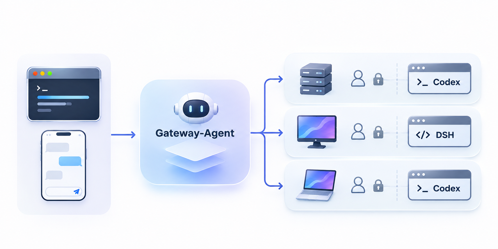
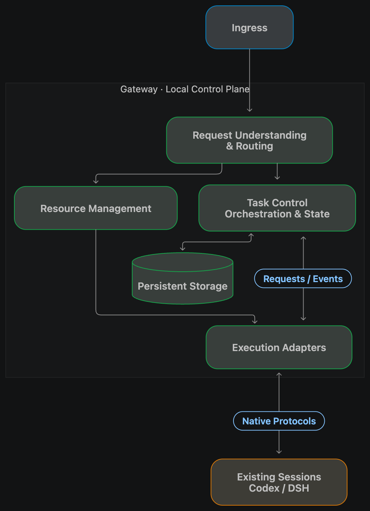

# Gateway-Agent

<p align="center">
  
</p>

<p align="center">
  轻量级、跨设备的 AI Agent 会话管理网关
</p>

<p align="center">
  <a href="#quick-start">Quick Start</a> ·
  <a href="#setup">Setup</a> ·
  <a href="#feishu">Feishu</a> ·
  <a href="#architecture">Architecture</a>
</p>

**Gateway-Agent** 是一个基于 **Ownership-Decoupled** 理念的轻量级 AI Agent 会话管理网关。它无需接管或重新启动已有 Session，即可跨设备、跨环境统一发现、监控和操作由不同客户端持有的 Codex、DSH 等 Agent 会话。通过 CLI、飞书等入口，用户可以直接使用自然语言交互，由 Gateway 结合上下文记忆自动定位目标 Session、判断操作意图、投递指令并追踪任务回执。其核心目标是**将 Session 的访问控制与原生所有权解耦**，以最低的环境配置和接入成本，实现随时随地的 Agent 协同管理。

## 为什么是 Gateway-Agent

传统的 Agent 管理方式通常要求网关创建、持有、重启或接管 Session。Gateway-Agent 不这样做。

- **Session 仍归属原生客户端**：Codex 面板、DSH 或其他客户端继续拥有 Session。
- **访问控制与所有权解耦**：Gateway 只负责发现、路由、投递和回执。
- **自然语言优先**：不需要记 Session ID，也不要求固定命令格式。
- **跨设备统一入口**：Console、飞书都可以作为统一控制面。
- **本地优先**：运行数据、凭据和绑定信息都留在本机。

## 核心能力

| 能力 | 说明 |
|---|---|
| Session Discovery | 发现本机或远端已经存在的 Codex / DSH Session |
| Natural Language Routing | 由 LLM 结合 Session 目录、focus 和 memory 选择目标 |
| Task Delivery | 通过原生 owner IPC、DSH bridge 或 SSH 投递任务 |
| Completion Tracking | 接收 HTTP hook、DSH feed、Codex watcher 的完成事件 |
| Durable Orchestration | DBOS 负责任务提交和完成工作流 |
| Receipts | 在 Feishu 中返回提交状态和任务简报 |
| Optional Feishu Ingress | 飞书是可选入口，Console 不依赖飞书 |

## Quick Start

### 环境要求

- Python 3.13
- 已安装并登录的 Codex CLI，或已运行的 DSH
- 如果要接入远端：可用的 SSH host 和 key 登录

Gateway 不会安装 Codex、DSH、SSH key，也不会创建 Session。

### 安装

从源码安装：

```bash
git clone <repository-url> gateway-agent
cd gateway-agent
python3.13 -m venv .venv
. .venv/bin/activate
python -m pip install --upgrade pip
python -m pip install .
```

Textual Console 已包含在默认安装中。

### 初始化

```bash
gateway-agent init
```

`init` 会创建：

```text
config/       私有配置
data/         运行数据
logs/         日志
config/.env   私有环境变量
```

默认不启用飞书。Feishu 是可选入口。

### 启动

```bash
gateway-agent start
gateway-agent console
```

Console 支持自然语言：

```text
列出会话
让远端 codex 的 add a new test 会话返回 OK
现在有哪些工作区
```

## Setup

`gateway-agent setup` 是面向非飞书环境的引导式配置入口，复用现有 `init`、`connect` 和 workspace 注册流程。

### 交互式

```bash
gateway-agent setup
```

会依次处理：

1. 本地初始化（如尚未初始化）
2. Router provider（DeepSeek / OpenAI-compatible / Codex）
3. Codex command
4. 可选：连接远端 host
5. 可选：登记 workspace

### 非交互式

```bash
printf '%s\n' "$DEEPSEEK_API_KEY" | gateway-agent setup --non-interactive \
  --provider deepseek --api-key-stdin \
  --host my-host --workspace /home/user/workspace
```

### 可以自动完成

- `init` 私有目录和模板
- `.env` 中的 router / Codex 配置
- `connect HOST` 的 bridge、completion endpoint、Codex Stop hook
- workspace 注册

### 仍需人工完成

- 安装 Codex / DSH
- 配置 SSH key 和 host
- 重载 DSH 面板以加载新 bridge
- 在 Codex 中信任 Stop hook 一次

`setup` 在已有完整配置时不会重复写入 `.env`。

## 支持的模型后端

`GATEWAY_ROUTER_BACKEND` 支持：

```text
auto
deepseek
codex
```

- `deepseek`：DeepSeek 或任意 OpenAI-compatible `/chat/completions` 服务
- `codex`：使用 Codex CLI 作为结构化路由模型
- `auto`：有 DeepSeek API Key 时使用 DeepSeek，否则回退 Codex

OpenAI-compatible 示例：

```env
GATEWAY_ROUTER_BACKEND=deepseek
DEEPSEEK_API_KEY=...
DEEPSEEK_BASE_URL=https://api.openai.com/v1
DEEPSEEK_MODEL=gpt-4.1-mini
DEEPSEEK_THINKING=off
```

## Feishu

<a id="feishu"></a>

飞书是可选 ingress，不是安装必需项。Console 和 daemon 不依赖飞书。

### 本地配置

```bash
gateway-agent ingress enable --app-id cli_xxx --app-secret-stdin
gateway-agent start
gateway-agent ingress status
gateway-agent ingress bind feishu
```

`ingress enable` 从 stdin 或环境变量读取 App Secret，不会打印密钥。

### 飞书侧需要完成

1. 创建飞书自建应用
2. 启用机器人能力
3. 订阅 `im.message.receive_v1`
4. 使用长连接模式
5. 授予消息收发权限
6. 把机器人加入目标群或直接使用 p2p
7. 在本地执行 `ingress bind feishu`
8. 给机器人发送 `绑定 123456`

绑定成功后，只有绑定的 chat 和 sender 会被处理。

## Architecture

<a id="architecture"></a>



Gateway 分为控制面、执行边界和原生传输层，但不拥有 Session。

### Request Path

```text
Ingress
        ↓
AskRuntime / Focus / Memory
        ↓
OperationDispatcher
        ├─ Management Operations
        │    host / workspace / session / doctor
        └─ task.prompt
                 ↓
        TaskRuntimeWorkflow.run (DBOS)
          prepare step → dispatch step
                 ↓
        TaskRuntime
          state, lease, journal, delivery identity
                 ↓
        ExecutionPort
                 ↓
        Codex owner IPC / DSH bridge / SSH
```

### Completion Path

```text
HTTP hook / DSH feed / Codex watcher / watchdog
        ↓
CompletionSource
  normalizes native facts into CompletionEvent
        ↓
TaskRuntime.complete_from_event
        ↓
TaskRuntimeWorkflow.complete_task (DBOS)
        ↓
persist → release → receipt
```

### Ownership Boundaries

| Component | Owns |
|---|---|
| `AskRuntime` / planner | 只选择一个 Operation |
| `OperationDispatcher` | 校验和路由 |
| `TaskRuntimeWorkflow` | DBOS 编排 |
| `TaskRuntime` | 业务状态、lease、journal、delivery identity |
| `ResultStore` | 任务状态和结果 |
| `ExecutionJournal` | 提交和完成证据 |
| `DeliveryStore` | 回执和 egress 状态 |
| `ExecutionPort` | 执行隔离：submit / list / status / completion source |
| `CompletionSource` | completion transport 和原生事件归一化 |
| `SessionArbiter` | per-session lease |
| execution adapters | 只负责 Codex / DSH / SSH 通信 |

关键边界：

- `task.prompt` 只有一个入口：`TaskRuntimeWorkflow.run`
- completion 只有一个入口：`TaskRuntimeWorkflow.complete_task`
- 只有 `TaskRuntime` 写业务状态并调用 `ExecutionPort.submit`
- `CompletionSource` 不写业务状态
- terminal 状态不回退
- Gateway 不创建、恢复、持有或重启 Session

## Configuration

主要配置文件：

```text
config/.env                       router / API / Codex
config/daemon.json                daemon 参数
config/.gateway-ssh.json          SSH hosts
config/.gateway-dsh.json          DSH transports
config/.gateway-workspaces.json   workspace 权限
config/ingress.json               Feishu ingress
```

所有私有文件权限为 `0600`，运行目录不进入 git。

## Upgrade

DBOS 持久化 workflow ID、workflow name、step name、payload 和 application version。当前 workflow 契约由测试冻结。

升级采用排空方式：

1. `gateway-agent stop`
2. 确认没有未完成 task
3. 确认没有 `PENDING` / `ERROR` DBOS workflow
4. 备份 `config/`、`data/`、`logs/`（如果需要）
5. `gateway-agent start`

不要在已有在途 workflow 时原地重命名或重构 workflow/step。

## CLI

```bash
gateway-agent init
gateway-agent setup
gateway-agent start
gateway-agent status
gateway-agent stop
gateway-agent console
gateway-agent ingress enable --app-id APP_ID --app-secret-stdin
gateway-agent ingress bind feishu
gateway-agent config show
```

查看帮助：

```bash
gateway-agent help
gateway-agent help setup
```

## Security

- 不接管、不重启、不持有已有 Session
- Feishu 只接受绑定 chat/sender 的消息
- API Key 通过 stdin / 环境变量读取
- 私有文件 `0600`
- 运行数据、日志、绑定和凭据不进入版本控制
- DBOS 任务工作流与业务状态分离

## License

MIT
